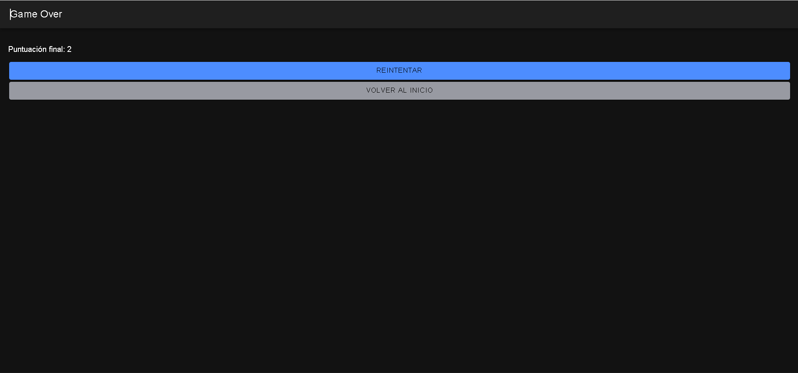
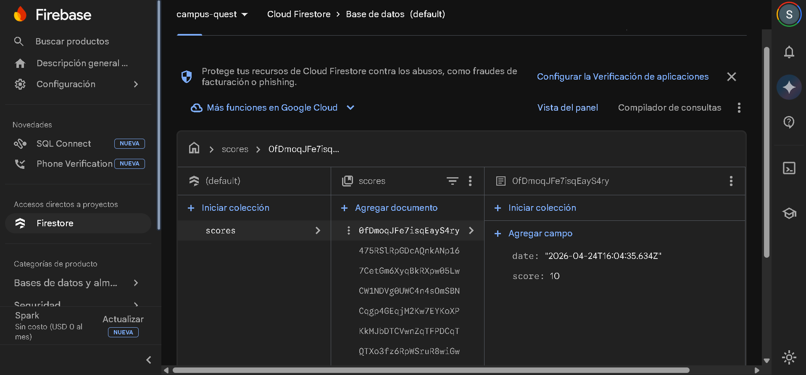

# Campus Quest

Aplicación desarrollada con **Ionic, Angular y TypeScript** que combina la gestión de tareas obtenidas de una API externa con un minijuego interactivo creado mediante Phaser.

Proyecto académico de la asignatura **Programación multimedia y dispositivos móviles**, del CFGS de Desarrollo de Aplicaciones Multiplataforma (DAM).

## Funcionalidades

### Navegación y gestión de tareas

- Pantalla de inicio personalizada con el nombre del usuario.
- Navegación entre las distintas secciones de la aplicación.
- Consulta de tareas obtenidas mediante una API REST externa (JSONPlaceholder).
- Posibilidad de compartir tareas mediante la funcionalidad de compartir del dispositivo.

### Minijuego interactivo

- Juego desarrollado con Phaser e integrado en la aplicación Ionic.
- Movimiento horizontal del jugador.
- Objetos azules que permiten acumular puntos.
- Objetos rojos que penalizan al jugador.
- Finalización de la partida al recibir tres golpes.
- Controles para pausar, reanudar y reiniciar.
- Almacenamiento de puntuaciones mediante Firebase.
- Pantalla de finalización de partida.

## Tecnologías utilizadas

- **TypeScript:** lógica de la aplicación.
- **Ionic 8:** componentes e interfaz de usuario.
- **Angular 20:** estructura, navegación y servicios.
- **Phaser:** desarrollo del minijuego.
- **Firebase:** almacenamiento de puntuaciones.
- **JSONPlaceholder:** API REST para obtener tareas.
- **Capacitor Share:** integración de la función de compartir.

## Capturas de pantalla

### Pantalla de inicio


### Listado de tareas


### Compartir tareas


### Minijuego


### Fin de partida


### Almacenamiento en Firebase


## Organización del proyecto

El código principal se encuentra en `campus-quest/`.

La aplicación está organizada en pantallas y servicios, separando las responsabilidades de la interfaz, la obtención de tareas y la gestión de puntuaciones.

Las principales pantallas son:

- `home`: inicio de la aplicación.
- `tasks`: consulta y compartición de tareas.
- `game`: minijuego interactivo.
- `game-over`: finalización de la partida.

## Ejecución local

**Requisitos:** Node.js, npm e Ionic CLI.

Desde la raíz del repositorio:

```bash
cd campus-quest
npm install
npx ionic serve
```

La aplicación se abrirá en el navegador local. Las funciones que dependen de Firebase requieren una configuración válida del servicio.

## Contexto académico

Proyecto final de la asignatura Programación multimedia y dispositivos móviles, desarrollado durante el CFGS de Desarrollo de Aplicaciones Multiplataforma.

El objetivo fue integrar navegación entre pantallas, consumo de servicios externos, funcionalidades del dispositivo y desarrollo de un videojuego dentro de una misma aplicación.

**Autor:** Siro Gascón Ogasawara
